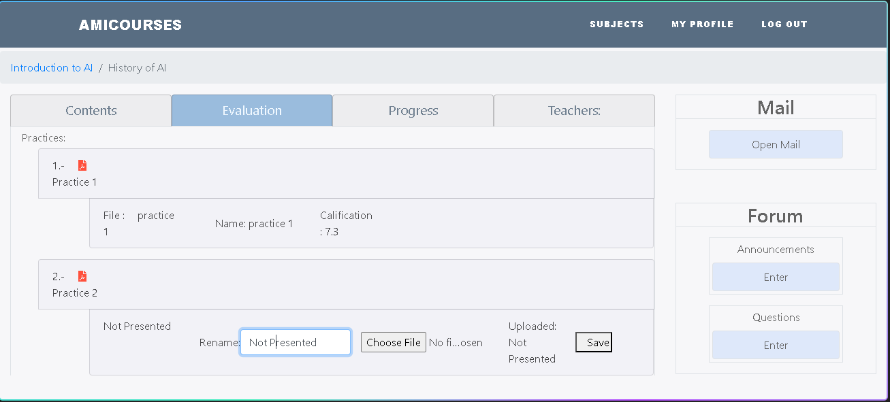
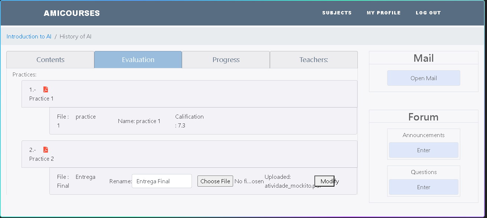
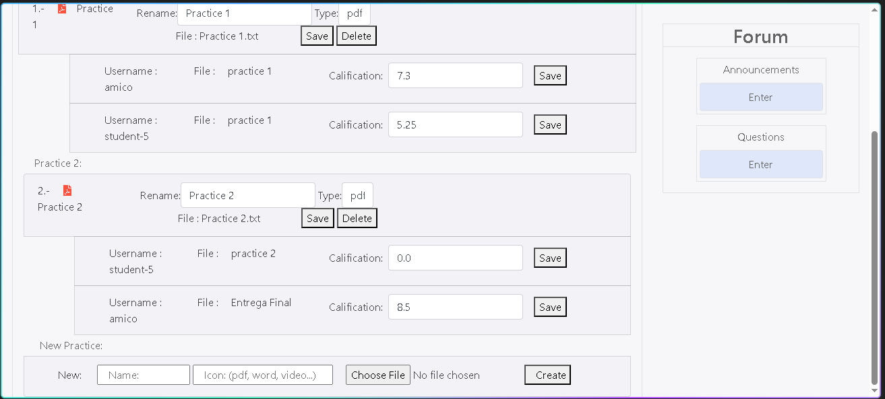
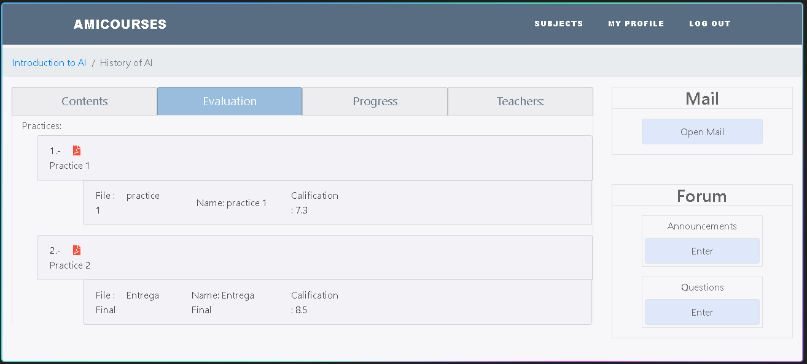
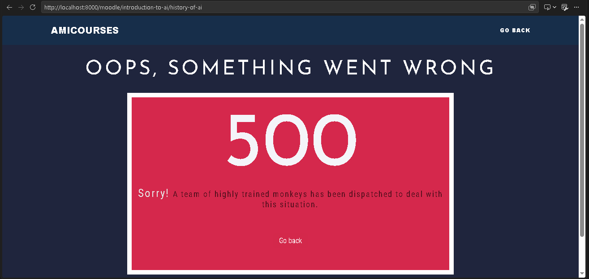
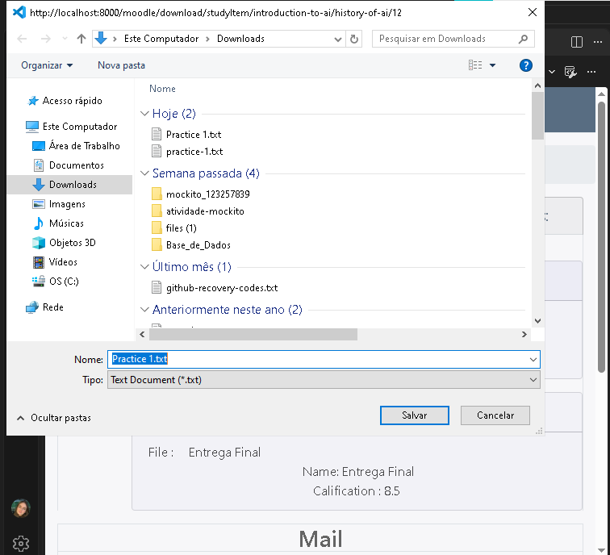
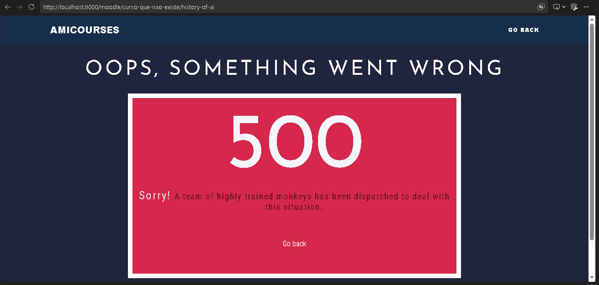

# Casos de teste manuais: submissão e correção de práticas (Moodle)

Funcionalidade testada: o fluxo de práticas dentro da página de uma disciplina
do Moodle - aluno visualiza a prática, submete o arquivo e o professor corrige
atribuindo nota. Métodos exercitados: `MoodleController.allCourses`,
`MoodleController.modifyPractice` e `MoodleController.updateCalificationPractice`.

Os casos CT-PRAT-01 a CT-PRAT-07 também estão modelados no TestLink, com
export XML em `docs/testlink-praticas-moodle.xml`.

Os testes unitários dessa mesma classe estão em
`AMICOServer/src/test/java/com/example/demo/controllers/MoodleControllerTest.java`.

## Preparação do ambiente

1. Usar o **JDK 8** (o projeto é Java 1.8).
2. Na pasta `AMICOServer`, rodar `mvn spring-boot:run`.
3. Abrir http://localhost:8000 no navegador (a porta é a 8000, configurada em
   `application.properties`).
4. O banco é H2 em memória: ao reiniciar a aplicação, os dados voltam ao estado
   inicial. Reinicie sempre que um caso pedir "dados originais".

Usuários dos dados iniciais usados aqui:

| Usuário        | Senha  | Papel                                       |
| -------------- | ------ | ------------------------------------------- |
| `amico`        | `pass` | Aluno, inscrito no curso Introduction to AI |
| `amicoTeacher` | `pass` | Professor da disciplina History of AI       |
| `admin`        | `pass` | Admin (também professor de History of AI)   |

Curso/disciplina usados: **Introduction to AI** -> disciplina **History of AI**
(3 módulos, com itens de estudo e 2 práticas: "Practice 1" e "Practice 2").
Nos dados originais, `amico` **já tem submissão** em Practice 1 (nome
"practice 1", nota 7.3, corrigida); em **Practice 2** ele **não tem
submissão** (a existente é de `student-5`, sem nota).

## Casos de teste

### CT-PRAT-01: Aluno visualiza suas práticas (própria submissão e "Not Presented")

- **Objetivo:** Verificar que, ao abrir a página da disciplina, o aluno vê a
  própria submissão onde já existe e "Not Presented" onde não existe; as
  submissões de outros alunos não aparecem.
- **Pré-condições:** Aplicação recém-iniciada (dados originais). `amico` logado.
- **Resultado esperado:** Practice 1 mostra a submissão do próprio amico (nota
  7.3); Practice 2 mostra "Not Presented"; nada de `student-0` ou `student-5`.

| Passo | Ação                                                                | Resultado esperado do passo                                                                     |
| ----- | ------------------------------------------------------------------- | ----------------------------------------------------------------------------------------------- |
| 1     | Abrir http://localhost:8000/login e entrar com `amico` / `pass`     | Login realizado e página inicial exibida.                                                       |
| 2     | Abrir http://localhost:8000/moodle/introduction-to-ai/history-of-ai | Página da disciplina History of AI exibida, com os módulos 1, 2 e 3 e seus itens.               |
| 3     | Localizar a seção de práticas (âncora "Evaluation")                 | "Practice 1" aparece com a submissão do próprio amico: "Name: practice 1", "Calification: 7.3". |
| 4     | Verificar "Practice 2"                                              | Aparece como "Not Presented", com formulário de rename/upload disponível.                       |
| 5     | Verificar se submissões de outros alunos aparecem                   | Não aparecem - cada aluno vê apenas a própria submissão.                                        |

### CT-PRAT-02: Aluno submete uma prática (renomeia e envia arquivo)

- **Objetivo:** Verificar o fluxo principal de submissão: o aluno renomeia a
  prática e envia um arquivo.
- **Pré-condições:** Executar antes o CT-PRAT-01 (`amico` logado, sem
  submissão em Practice 2). Ter um arquivo pronto para upload (ex.:
  `minha-entrega.pdf`).
- **Resultado esperado:** A submissão passa a exibir o novo nome e o arquivo
  enviado; status deixa de ser "Not Presented".

| Passo | Ação                                                | Resultado esperado do passo                                                                           |
| ----- | --------------------------------------------------- | ----------------------------------------------------------------------------------------------------- |
| 1     | Na página da disciplina, localizar "Practice 2"     | A prática aparece com "Not Presented" e o formulário de submissão (campo Rename + arquivo + Save).    |
| 2     | No campo "Rename", digitar "Entrega final"          | O campo aceita o texto.                                                                               |
| 3     | No campo de arquivo, selecionar `minha-entrega.pdf` | O nome do arquivo aparece no campo.                                                                   |
| 4     | Clicar em "Save"                                    | A página recarrega (redirect para a mesma disciplina).                                                |
| 5     | Verificar "Practice 2" novamente                    | A submissão aparece com o nome "Entrega final" e o arquivo enviado; "Not Presented" não aparece mais. |

### CT-PRAT-03: Professor corrige a prática e atribui nota

- **Objetivo:** Verificar o fluxo de correção: o professor atribui uma nota e
  a prática é marcada como corrigida.
- **Pré-condições:** Executar antes o CT-PRAT-02 (`amico` já submeteu
  "Entrega final" em Practice 2). Sair da conta do aluno e entrar como
  `amicoTeacher` / `pass`.
- **Resultado esperado:** A nota atribuída fica visível e a submissão é
  marcada como corrigida.

| Passo | Ação                                                                | Resultado esperado do passo                                                         |
| ----- | ------------------------------------------------------------------- | ----------------------------------------------------------------------------------- |
| 1     | Sair da conta do aluno e entrar como `amicoTeacher` / `pass`        | Login realizado.                                                                    |
| 2     | Abrir http://localhost:8000/moodle/introduction-to-ai/history-of-ai | Página da disciplina exibida; o professor vê a lista de alunos (aba de estudantes). |
| 3     | Localizar a submissão "Entrega final" de `amico` (em Practice 2)    | A submissão aparece sem nota (0.0) e não corrigida.                                 |
| 4     | Atribuir a nota 8.5 e confirmar                                     | A página recarrega; a submissão passa a exibir a nota 8.5 e status de corrigida.    |

### CT-PRAT-04: Aluno não pode atribuir nota

- **Objetivo:** Verificar o controle de acesso na correção: aluno não consegue
  alterar notas.
- **Pré-condições:** Aplicação recém-iniciada. `amico` logado. A submissão de
  `student-5` em Practice 2 existe nos dados originais.
- **Resultado esperado:** Nenhuma ação de nota é oferecida/executada para o
  aluno; a nota permanece inalterada.

| Passo | Ação                                                                                                                                                                    | Resultado esperado do passo                                                      |
| ----- | ----------------------------------------------------------------------------------------------------------------------------------------------------------------------- | -------------------------------------------------------------------------------- |
| 1     | Entrar como `amico` / `pass`                                                                                                                                            | Login realizado.                                                                 |
| 2     | Abrir http://localhost:8000/moodle/introduction-to-ai/history-of-ai                                                                                                     | Página da disciplina exibida.                                                    |
| 3     | Procurar campo/formulário de atribuição de nota                                                                                                                         | Não existe formulário de nota para o aluno (a interface não oferece a ação).     |
| 4     | (Opcional, via devtools) Submeter POST para `/moodle/practice/update-calification/introduction-to-ai/history-of-ai/{studyItemID}/{practiceID}` com `newCalification=10` | A nota da submissão permanece a original (a regra `!user.isStudent()` bloqueia). |

### CT-PRAT-05: Professor gerencia práticas, mas não submete

- **Objetivo:** Verificar o que o professor vê na seção de práticas: ele
  gerencia o item da prática (rename/delete do enunciado) e corrige submissões
  (nota), mas **não** possui o formulário de submissão de aluno (campo de
  arquivo + Uploaded).
- **Pré-condições:** Aplicação recém-iniciada. `amicoTeacher` logado.
- **Resultado esperado:** O professor vê, para cada prática: o formulário de
  gerência do item (Rename + Type + File + Save + Delete) e a lista de
  submissões dos alunos com campo de Calification. **Não** vê o formulário de
  submissão do aluno (campo de arquivo).

| Passo | Ação                                                                         | Resultado esperado do passo                                                                                   |
| ----- | ---------------------------------------------------------------------------- | ------------------------------------------------------------------------------------------------------------- |
| 1     | Entrar como `amicoTeacher` / `pass`                                          | Login realizado.                                                                                              |
| 2     | Abrir http://localhost:8000/moodle/introduction-to-ai/history-of-ai          | Página da disciplina exibida (o professor é da disciplina).                                                   |
| 3     | Na seção Evaluation, observar o formulário junto a "Practice 1"              | Formulário de gerência do item: Rename + Type + File + Save + **Delete** (sem campo de arquivo de submissão). |
| 4     | Observar as submissões listadas abaixo do item                               | Cada submissão mostra "Username: \<aluno\>" + File + campo **Calification** + Save.                           |
| 5     | Procurar o formulário de submissão do aluno (campo de arquivo + "Uploaded:") | Não existe para o professor - a interface não oferece a ação.                                                 |

### CT-PRAT-06: Usuário não-inscrito não acessa a página da disciplina

- **Objetivo:** Verificar o controle de acesso da página: usuário fora do
  curso recebe a página de erro.
- **Pré-condições:** Aplicação recém-iniciada. Usuário logado que NÃO está
  inscrito em Introduction to AI. Nos dados originais, o curso tem os alunos
  `student-0` a `student-34` (mais amico, professores e admin); o primeiro
  aluno fora dele é o **`student-35`** (senha `pass-35`).
- **Resultado esperado:** Página de erro amigável; a disciplina não é exibida.

| Passo | Ação                                                                | Resultado esperado do passo                                   |
| ----- | ------------------------------------------------------------------- | ------------------------------------------------------------- |
| 1     | Entrar como `student-35` / `pass-35`                                | Login realizado.                                              |
| 2     | Abrir http://localhost:8000/moodle/introduction-to-ai/history-of-ai | Página de erro amigável exibida (não a página da disciplina). |

**Resultado obtido:** Passou. O acesso foi bloqueado (a disciplina não foi
exibida) e o usuário recebeu a página de erro amigável do projeto
("Oops, something went wrong - 500", template `HTML/ErrorPages/500Error.html`,
com navegação de volta). Observação técnica: o caminho é indireto - o
controller retorna a view `"/error/"`, que não existe como template, e o
Spring Boot encaminha para o handler de erro, que renderiza a página
customizada. Funcionalmente correto; semanticamente, um status 403
("acesso negado") seria mais adequado que 500 - melhoria possível, não defeito.

### CT-PRAT-07: Aluno baixa apenas a própria submissão

- **Objetivo:** Verificar a regra de download: aluno consegue baixar a própria
  submissão, mas não a de outro aluno.
- **Pré-condições:** Aplicação recém-iniciada. `amico` logado. A submissão de
  `amico` em Practice 1 é a practiceID 1; a de `student-5` em Practice 2 é a
  practiceID 3 (a practiceID 4 é a submissão "Not Presented" do próprio
  amico, criada quando ele visita a página).
- **Resultado esperado:** Download da própria submissão funciona; tentativa de
  baixar a submissão de outro aluno não retorna arquivo.

| Passo | Ação                                                                                                                         | Resultado esperado do passo                                                                          |
| ----- | ---------------------------------------------------------------------------------------------------------------------------- | ---------------------------------------------------------------------------------------------------- |
| 1     | Entrar como `amico` / `pass` e abrir a página da disciplina                                                                  | Página exibida.                                                                                      |
| 2     | Baixar a própria submissão em Practice 1 (link "File: practice 1")                                                           | O arquivo é baixado com o conteúdo correto.                                                          |
| 3     | Tentar baixar a submissão de `student-5` (via URL direta `/moodle/download/studyItem/introduction-to-ai/history-of-ai/13/3`) | Nenhum arquivo é retornado (a regra `practice.getOwner().getUserID() == user.getUserID()` bloqueia). |

**Resultado obtido:** Passou, com ressalva. O passo 2 retornou o arquivo
correto ("This is the practice 1 from amico", 33 bytes). O passo 3, executado
com `curl -i`, retornou **HTTP 200 com corpo de 0 bytes** - o conteúdo não é
entregue, mas a resposta não indica erro (sem 403/404). A regra de acesso
funciona; a semântica HTTP está incorreta. Defeito de semântica HTTP (200
em vez de 403/404); sem issue aberta até o momento.

Observação de execução: a primeira tentativa do passo 3 usou a URL `/13/4`,
que não é a submissão de outro aluno - o practiceID 4 é a submissão "Not
Presented" do próprio amico (criada ao visitar a página), e o download dela
retornou 200 com 140835 bytes (arquivo físico herdado de dados anteriores no
disco). A URL foi corrigida para `/13/3` e o caso re-executado.

## Casos de entrada inválida (CT-08 a CT-12)

Estes casos verificam a validação no servidor, enviando requisições diretas
(via `curl`) que ignoram a interface. A motivação: os limites do formulário
(`min`/`max` do HTML, campos obrigatórios) são validação de cliente; o que
interessa é o que o servidor aceita quando alguém envia a requisição direta.

Método de execução: login via `curl -c cookies.txt -X POST /login` (o app usa
sessão por cookie, não HTTP Basic), seguido das requisições com
`curl -b cookies.txt`. Após cada requisição, o estado foi verificado
recarregando a página da disciplina e inspecionando o HTML retornado.

### CT-08: Nota negativa (-5)

- **Objetivo:** Verificar se o servidor valida o valor mínimo da nota.
- **Pré-condições:** `amicoTeacher` logado via curl. Submissão do amico em
  Practice 1 (practiceID 1).
- **Resultado esperado:** A nota não deveria aceitar valores abaixo de 0.

| Passo | Ação                                                                                                                        | Resultado esperado do passo                     |
| ----- | --------------------------------------------------------------------------------------------------------------------------- | ----------------------------------------------- |
| 1     | `curl -b cookies_teacher.txt -X POST .../update-calification/introduction-to-ai/history-of-ai/12/1 -d "newCalification=-5"` | Requisição rejeitada ou nota inalterada.        |
| 2     | Recarregar a página da disciplina e verificar a nota                                                                        | Nota permanece dentro da faixa válida (0 a 10). |

**Resultado obtido:** HTTP 302 e a nota **-5.0 foi gravada**. O servidor
aceita qualquer `Double` sem validação de faixa; o `min="0"` do formulário é
validação apenas de cliente. Issue #13.

### CT-09: Nota acima do máximo (1000)

- **Objetivo:** Verificar se o servidor valida o valor máximo da nota.
- **Pré-condições:** `amicoTeacher` logado via curl.
- **Resultado esperado:** A nota não deveria aceitar valores acima de 10.

| Passo | Ação                                                                                                                          | Resultado esperado do passo              |
| ----- | ----------------------------------------------------------------------------------------------------------------------------- | ---------------------------------------- |
| 1     | `curl -b cookies_teacher.txt -X POST .../update-calification/introduction-to-ai/history-of-ai/12/1 -d "newCalification=1000"` | Requisição rejeitada ou nota inalterada. |
| 2     | Recarregar a página e verificar a nota                                                                                        | Nota permanece dentro da faixa válida.   |

**Resultado obtido:** HTTP 302 e a nota **1000.0 foi gravada**. Mesmo
defeito do CT-08: validação de faixa inexistente no servidor. Issue #13
(junto com o CT-08).

### CT-10: Nota com texto ("abc")

- **Objetivo:** Verificar o comportamento com entrada não numérica.
- **Pré-condições:** `amicoTeacher` logado via curl.
- **Resultado esperado:** Rejeição com mensagem amigável.

| Passo | Ação                                                                                                                         | Resultado esperado do passo              |
| ----- | ---------------------------------------------------------------------------------------------------------------------------- | ---------------------------------------- |
| 1     | `curl -b cookies_teacher.txt -X POST .../update-calification/introduction-to-ai/history-of-ai/12/1 -d "newCalification=abc"` | Erro tratado com mensagem compreensível. |

**Resultado obtido:** HTTP 400 (falha de conversão String para Double no
Spring). A requisição foi rejeitada corretamente, mas a resposta é a página de
erro padrão, sem mensagem orientada ao usuário. Melhoria de usabilidade,
registrada como observação.

### CT-11: Submissão sem arquivo (rename com arquivo vazio)

- **Objetivo:** Verificar se a prática pode ser marcada como entregue sem um
  arquivo real. O código de `modifyPractice` executa `setPresented(true)` quando
  o nome é preenchido, sem validar o arquivo.
- **Pré-condições:** `amico` logado via curl. Practice 2 sem submissão
  apresentada.
- **Resultado esperado:** A prática não deveria ser marcada como entregue sem
  um arquivo válido.

| Passo | Ação                                                                                                                                                                                                                            | Resultado esperado do passo                |
| ----- | ------------------------------------------------------------------------------------------------------------------------------------------------------------------------------------------------------------------------------- | ------------------------------------------ |
| 1     | `curl -b cookies_amico.txt -X POST .../practice/modify/introduction-to-ai/history-of-ai/13/4 -F "newName=Entrega sem arquivo" -F "itemFile=@vazio.txt"` (arquivo sem conteúdo; o criado pelo `Set-Content` tem 2 bytes de CRLF) | Requisição rejeitada ou status inalterado. |
| 2     | Recarregar a página e verificar Practice 2                                                                                                                                                                                      | A prática continua "Not Presented".        |

**Resultado obtido:** HTTP 302 e a prática passou a aparecer como
**"Entrega sem arquivo"** com link de download (status de entregue), embora o
arquivo enviado não tivesse conteúdo útil. O `setPresented(true)` é executado
com o nome preenchido, sem validar o conteúdo do arquivo. Issue #14 - o mais
grave encontrado, pois quebra a regra central do fluxo de práticas.

O link de download da submissão vazia foi testado: com o arquivo de 2 bytes,
o download retorna exatamente o que foi gravado (2 bytes); com um arquivo de
0 bytes reais, o upload é pulado (`isEmpty()`) e o link aponta para o arquivo
físico antigo da pasta (herdado de dados anteriores). Nos dois casos a
prática fica marcada como entregue.

Observação: com o campo `itemFile` ausente na requisição (multipart
incompleto), o servidor responde HTTP 400 - o campo é obrigatório no parsing
do Spring. O defeito se manifesta com um arquivo presente, porém sem conteúdo.

### CT-12: Rename vazio com arquivo

- **Objetivo:** Verificar o comportamento com nome vazio.
- **Pré-condições:** `amico` logado via curl.
- **Resultado esperado:** Nada é alterado (o código exige nome preenchido).

| Passo | Ação                                                                                                                                 | Resultado esperado do passo |
| ----- | ------------------------------------------------------------------------------------------------------------------------------------ | --------------------------- |
| 1     | `curl -b cookies_amico.txt -X POST .../practice/modify/introduction-to-ai/history-of-ai/13/4 -F "newName=" -F "itemFile=@vazio.txt"` | Nada é alterado.            |
| 2     | Recarregar a página                                                                                                                  | Estado inalterado.          |

**Resultado obtido:** Passou. HTTP 302 e nenhum dado foi alterado - o
`if (!newName.isEmpty())` protege este caminho.

## Registro de execução

Execução realizada em **11/10/2026 e 12/10/2026**, com a aplicação rodando
localmente (`mvn spring-boot:run`, JDK 8, http://localhost:8000, banco H2 em
memória com os dados iniciais).

**Ordem de execução e reinícios da aplicação** (o banco é em memória; cada
reinício volta aos dados originais):

1. CT-01 a CT-05: executados em sequência na mesma sessão (CT-02 depende do
   CT-01; CT-03 e CT-04 dependem do CT-02)
2. CT-06 e CT-07: mesma sessão; o CT-07 passo 3 foi re-executado em 12/10
   com a URL corrigida (`/13/3`), após nova sessão de login
3. Reinício da aplicação (dados originais)
4. CT-08 a CT-10: mesma sessão, em sequência (a nota da submissão 12/1 foi
   alterada por cada um: -5, depois 1000)
5. CT-11: mesma sessão (a submissão 13/4 foi criada ao visitar a página e
   depois renomeada com arquivo vazio)
6. CT-12: mesma sessão (rename vazio, nada alterado)
7. Reinício da aplicação (dados originais)
8. Reproduções dos defeitos de integridade e semântica HTTP: deleção de
   prática pelo professor, visita de aluno sem submissão (500), download
   alheio (200 vazio)

Os casos CT-01 a CT-07 foram executados pela interface; CT-08 a CT-12, via
requisições diretas com `curl` (login por cookie de sessão), com verificação
do estado no HTML retornado e na interface. As saídas dos comandos curl
estão em `docs/evidencias/moodle/evidencias-curl.md`.

| Caso       | Data       | Executor     | Resultado             | Evidência                                                                                                                                                                                                                                                                                                                                                                          |
| ---------- | ---------- | ------------ | --------------------- | ---------------------------------------------------------------------------------------------------------------------------------------------------------------------------------------------------------------------------------------------------------------------------------------------------------------------------------------------------------------------------------- |
| CT-PRAT-01 | 11/10/2026 | gabilima2004 | Passou                |  - Practice 1 com a submissão própria (nota 7.3) e Practice 2 como "Not Presented"; submissões de outros alunos não visíveis.                                                                                                                                                                                                       |
| CT-PRAT-02 | 11/10/2026 | gabilima2004 | Passou                |  - Practice 2 após submissão: nome "Entrega final" e arquivo enviado; "Not Presented" não aparece mais.                                                                                                                                                                                                                             |
| CT-PRAT-03 | 11/10/2026 | gabilima2004 | Passou                |  - Como `amicoTeacher`: submissão "Entrega final" de amico com Calification 8.5 e corrigida.                                                                                                                                                                                                                                        |
| CT-PRAT-04 | 11/10/2026 | gabilima2004 | Passou                |  - Como `amico`: nota 8.5 exibida sem qualquer campo de edição (a interface não oferece a ação ao aluno).                                                                                                                                                                                                                           |
| CT-PRAT-05 | 11/10/2026 | gabilima2004 | Passou                |  - Como `amicoTeacher`: formulário de gerência do item (Rename/Type/File/Save/Delete) + submissões dos alunos com campo Calification; sem formulário de submissão (campo de arquivo).                                                                                                                                               |
| CT-PRAT-06 | 11/10/2026 | gabilima2004 | Passou                |  - Como `student-35`: página de erro amigável do projeto exibida; disciplina não acessível. Observação: primeira execução usou `student-30`, que está inscrito no curso (premissa do caso corrigida para `student-35`).                                                                                                            |
| CT-PRAT-07 | 11/10/2026 | gabilima2004 | Passou (com ressalva) |  + [arquivo baixado](evidencias/moodle/Practice%201.txt) - Passo 2: download da própria submissão retorna o arquivo correto (33 bytes). Passo 3 (re-executado em 12/10 com a URL corrigida `/13/3`): HTTP 200 com corpo de 0 bytes - o conteúdo não é entregue, mas sem 403/404. Saídas em `evidencias/moodle/evidencias-curl.md`. |
| CT-08      | 11/10/2026 | gabilima2004 | Falhou (bug)          | Nota -5.0 gravada no banco (verificada no HTML da página após o POST via curl). Bug: nota sem validação de faixa no servidor. Issue #13.                                                                                                                                                                                                                                           |
| CT-09      | 11/10/2026 | gabilima2004 | Falhou (bug)          | Nota 1000.0 gravada no banco. Mesmo defeito do CT-08. Issue #13.                                                                                                                                                                                                                                                                                                                   |
| CT-10      | 11/10/2026 | gabilima2004 | Passou (com ressalva) | HTTP 400 com página de erro padrão do Spring, sem mensagem amigável. Requisição rejeitada corretamente.                                                                                                                                                                                                                                                                            |
| CT-11      | 11/10/2026 | gabilima2004 | Falhou (bug)          | Prática marcada como entregue ("Entrega sem arquivo", com link de download) com arquivo sem conteúdo útil. O link baixa o arquivo gravado (2 bytes de CRLF); com 0 bytes reais, o upload é pulado e o link aponta para arquivo físico antigo. Bug: `setPresented(true)` sem validar o arquivo. Issue #14. Saídas em `evidencias/moodle/evidencias-curl.md`.                        |
| CT-12      | 11/10/2026 | gabilima2004 | Passou                | Nenhum dado alterado com nome vazio; o `if (!newName.isEmpty())` protege o caminho.                                                                                                                                                                                                                                                                                                |

### Resumo dos defeitos encontrados nos casos de entrada inválida

| Defeito                                             | Caso         | Severidade sugerida          |
| --------------------------------------------------- | ------------ | ---------------------------- |
| Nota sem validação de faixa (aceita -5, 1000)       | CT-08, CT-09 | Média                        |
| Prática marcada como entregue com arquivo vazio     | CT-11        | Alta                         |
| Erro 400 sem mensagem amigável na conversão de nota | CT-10        | Baixa (passou, com ressalva) |

Issues abertas: nota sem faixa (#13), entrega vazia (#14), `count()` como
ID (#16), curso inexistente (#10). Sem issue aberta: disciplina inexistente
(500) e download bloqueado com 200 vazio.

### Reprodução dos NPEs no sistema em execução

Para responder à pergunta "o NPE visto no teste com mock acontece no sistema
real?", os três cenários foram reproduzidos com o app rodando, via requisições
diretas com `curl` (login por cookie de sessão):

| Cenário                | Requisição                                                                  | Resultado real     | Conclusão                                                                                                                                                                            |
| ---------------------- | --------------------------------------------------------------------------- | ------------------ | ------------------------------------------------------------------------------------------------------------------------------------------------------------------------------------ |
| Curso inexistente      | `GET /moodle/curso-que-nao-existe/history-of-ai` (logado)                   | HTTP 500           | Confirmado: NPE ocorre em execução. Evidência: . Defeito também reportado na issue #10 do repositório (página de curso inexistente). |
| Disciplina inexistente | `GET /moodle/introduction-to-ai/disciplina-inexistente` (logado e inscrito) | HTTP 500           | Confirmado: NPE ocorre em execução. Mesma evidência.                                                                                                                                 |
| Upload anônimo         | `POST /moodle/upload/studyItem/...` (anônimo)                               | HTTP 302 -> /login | Diferente do previsto: a segurança do Spring intercepta antes do controller; o NPE é latente (fragilidade), não ativo.                                                               |

Verificação adicional do upload anônimo: após a tentativa, nada foi
persistido (o item "Aula teste" não aparece na disciplina) - integridade
preservada.

### Observações da execução

1. **CT-PRAT-06 - correção de premissa:** a primeira versão do caso usava
   `student-30`, que nos dados iniciais **está** inscrito em Introduction to AI
   (o laço do `DataLoaderExample` inscreve `student-0` a `student-34`). O
   sistema exibiu a página corretamente - comportamento certo, premissa errada.
   O caso foi re-executado com `student-35` (primeiro aluno fora do curso).
2. **CT-PRAT-06 - caminho do erro:** o controller retorna a view `"/error/"`,
   que não existe como template; o Spring Boot encaminha para o handler de
   erro, que renderiza a página customizada `HTML/ErrorPages/500Error.html`
   ("Oops, something went wrong"). O resultado para o usuário é uma página de
   erro amigável com navegação de volta - funcionalmente correto. Melhoria
   possível (não defeito): um status 403 com página dedicada seria
   semanticamente mais adequado que 500.
3. **CT-PRAT-05 - esclarecimento:** o professor vê formulários Rename/Save na
   seção de práticas, mas são de **gerência do item** (enunciado da prática) e
   de **correção** (nota), conforme o template `student-subject.html`
   (`{{#isTeacher}}`). O formulário de submissão do aluno (campo de arquivo +
   "Uploaded:") não é renderizado para o professor - comportamento esperado.
4. **CT-PRAT-07 - cobertura dupla:** a regra de download de submissão alheia
   foi verificada manualmente (passo 3, HTTP 200 com corpo vazio) e também
   está coberta pelo teste unitário
   `downloadPractice_studentCannotDownloadAnotherStudentsPractice`.
